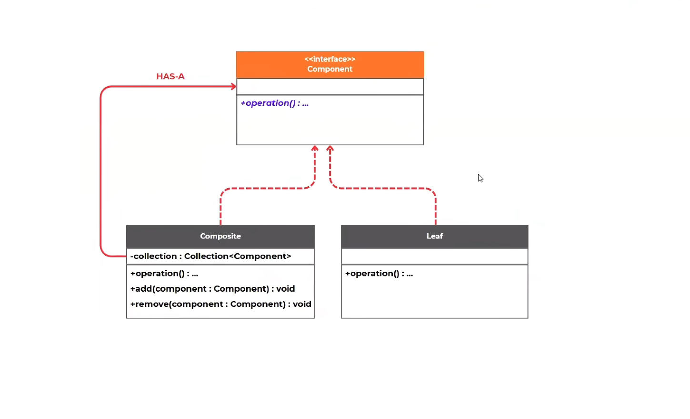
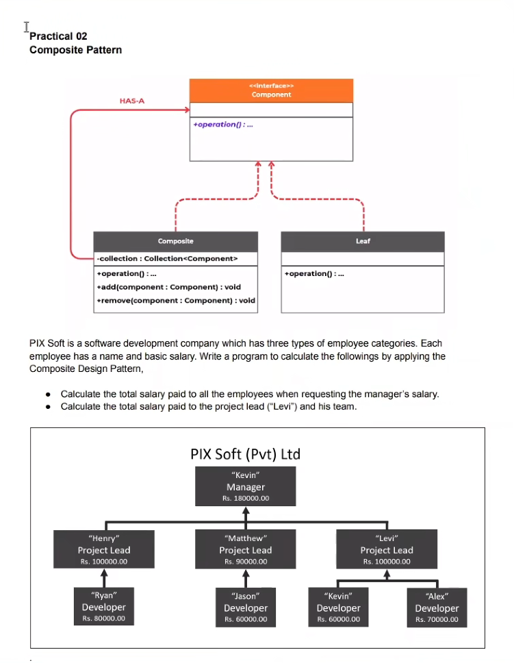
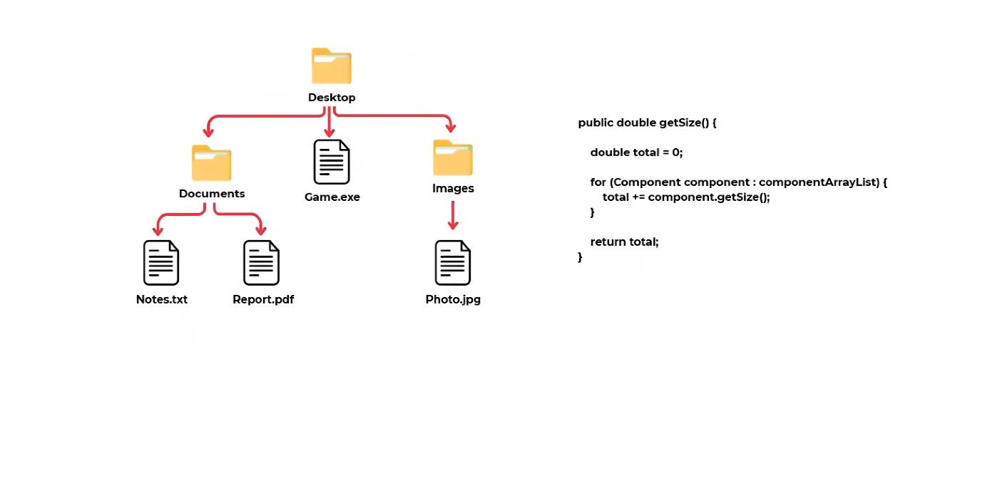
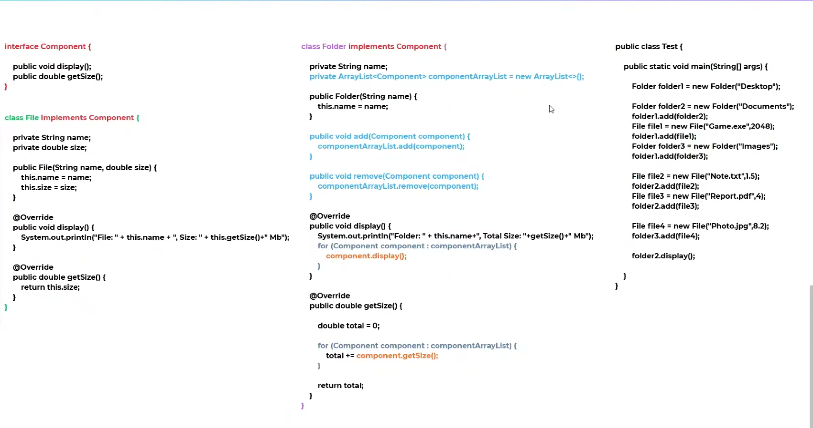

# Composite Design Pattern

This project demonstrates the Composite Design Pattern in Java using practical examples for employee hierarchy and file/folder structure.

## 1. What is the Composite Design Pattern?

The Composite Design Pattern is a structural design pattern that lets you treat individual objects and groups of objects uniformly.

It is useful when you need to represent a tree-like structure where:
- a single object and a group of objects should be handled in the same way
- operations should be applied recursively to all child elements
- a parent object and its children share a common interface

In simple terms, the pattern composes objects into tree structures to represent part-whole hierarchies.

## 2. Core Idea

The pattern uses a common component interface, which is implemented by:
- Leaf: a single object
- Composite: a container that holds child components

This allows the client code to work with both leaf and composite objects using the same API.

## 3. When to Use Composite Pattern

Use the Composite Pattern when:
- the system has a hierarchy or tree structure
- you want to treat leaf and container objects uniformly
- you need recursive operations such as total size, total salary, or traversal
- the object tree may grow dynamically

## 4. Suitable Scenarios

The Composite Pattern is suitable for:
- employee management hierarchy
- folder/file systems
- organization charts
- menu and sub-menu structures
- product categories and subcategories
- company departments and teams

## 5. Not Suitable Scenarios

Avoid using the Composite Pattern when:
- the objects do NOT share a common behavior or interface
- the hierarchy is not tree-based
- you require strict type-specific logic for each object without a common abstraction
- the relationship is more of a dependency or association than a part-whole composition
- you need to model a highly dynamic structure with many special cases, where simple recursion is not enough

## 6. Advantages

- simplifies client code by treating leaf and composite uniformly
- supports recursive traversal of nested objects
- easy to extend with new component types
- promotes cleaner design for tree-like structures
- reduces duplicated logic across node types

## 7. Disadvantages

- can become complex when the component hierarchy grows large
- may make the base component too general
- difficult to restrict operations only to certain types of components
- runtime type checks may be needed in some cases
- not ideal for systems that do not naturally form a tree

## 8. General Class Diagram

This pattern generally consists of these classes/interfaces:
- Component
- Leaf
- Composite
- Client

## 9. Project Structure

This repository includes multiple examples of the Composite Pattern:

### Employee Hierarchy Example
File: `src/main/java/lk/kaushalya/practical/Practical.java`

This example models a company structure:
- Manager
- Project Lead
- Developer

The goal is to calculate:
- total salary for the full company hierarchy
- total salary for a specific project lead and team

### File and Folder Example
File: `src/main/java/lk/kaushalya/model/Test.java`

This example models a file system structure:
- Folder
- File

The folder calculates total size recursively, which is a classic Composite Pattern use case.

### Code Snippet / Pattern Flow

## 10. Real-World Implementations

The Composite Design Pattern is commonly used in:

### a) Company Hierarchy
A company is made of departments, teams, and employees. A manager can supervise multiple teams, and each team may have many employees.

Example:
- Manager
- Department Manager
- Team Lead
- Developer

All of them can be treated as employees with a shared interface or abstract base.

### b) File System
A directory contains files and subdirectories. A file is a leaf while a folder is a composite node.

Example operations:
- get size
- display contents
- count total files
- traverse recursively

### c) Menu and Submenu
A menu can contain menu items and nested submenus. You can render, enable, or disable all items uniformly.

### d) Product Catalog
Product categories can contain subcategories and products. The whole catalog can be processed as one collection structure.

## 11. Java Implementation Notes

In this project, the pattern is implemented by defining a common interface and then creating:
- `Employee` / `Component` as the shared abstraction
- `Developer` / `File` as leaf objects
- `Supervisor` / `Folder` as composite objects

The composite objects maintain a list of child components and recursively aggregate results.

## 12. Example Output Behavior

The project demonstrates:
- printing employee details with hierarchy
- summing total salaries for manager and project team
- displaying folder contents
- calculating total storage size recursively

## 13. Files in This Repository

- `src/main/java/lk/kaushalya/practical/Practical.java` — employee hierarchy practical example
- `src/main/java/lk/kaushalya/model/Test.java` — folder/file composite example
- `src/main/java/lk/kaushalya/model/GenaralClassDiagram.png` — general class diagram
- `src/main/java/lk/kaushalya/model/structure.png` — structure diagram
- `src/main/java/lk/kaushalya/model/code.png` — code example screenshot
- `src/main/java/lk/kaushalya/practical/practical.png` — practical example screenshot

## 14. Final Check: All Required Items Added

- [x] README created
- [x] Composite Design Pattern theory explained
- [x] Usage / suitable scenarios added
- [x] Not suitable scenarios added
- [x] Advantages and disadvantages added
- [x] General class diagram added
- [x] Real-world implementations added
- [x] Project examples included
- [x] Images are referenced and present in the repository

## 15. Summary

The Composite Design Pattern is ideal when you need to model hierarchical systems where individual objects and groups of objects should be treated in the same way. It is especially useful for employee structures, file systems, menus, and product categories.

This repository demonstrates both the concept and a practical Java implementation clearly and visually.
